# Fablife
Healthy habit app

Fab Life is an Android app (Kotlin, Jetpack Compose) that helps people build a healthier lifestyle one tiny habit at a time through guided coaching journeys and daily rituals.

| Today | Coach letter | Journey |
|---|---|---|
| 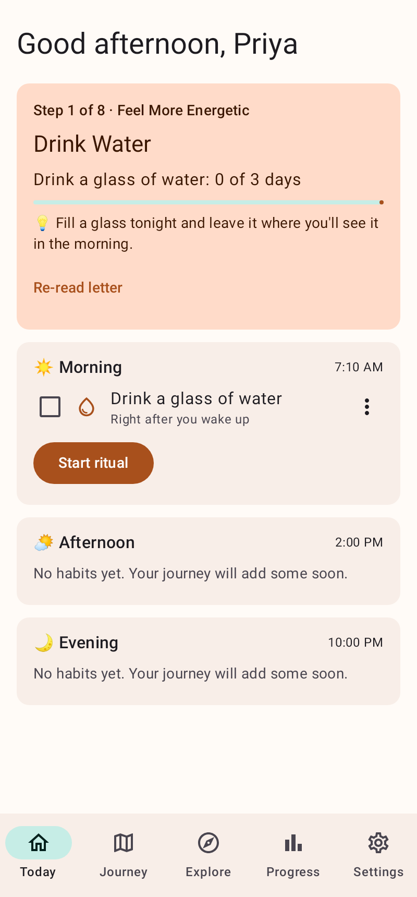 | 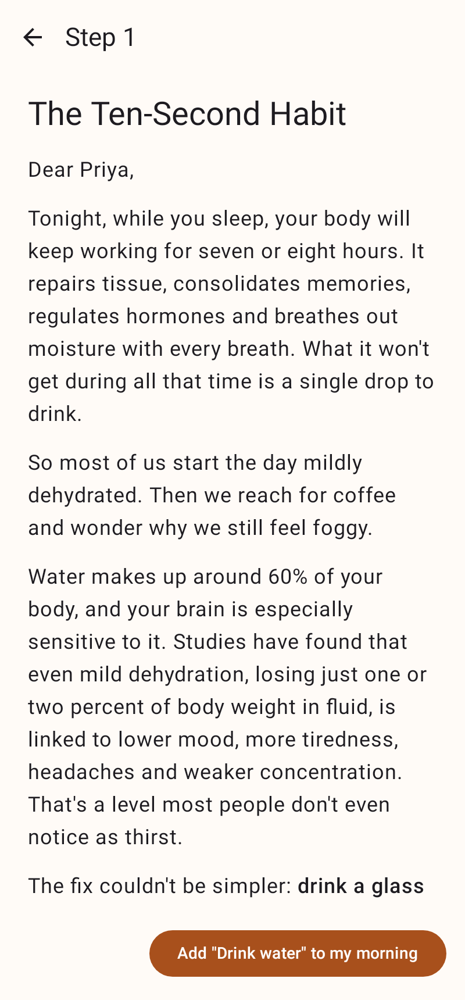 | 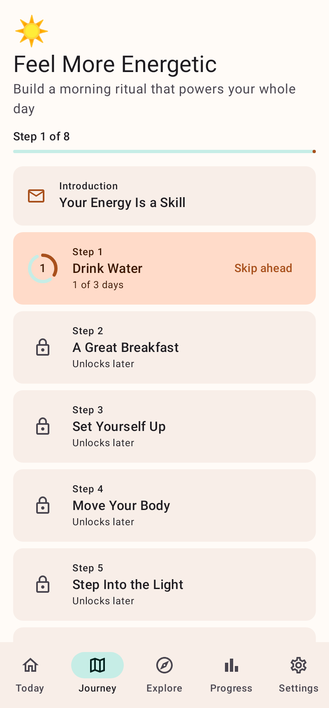 |
| **Move** | **Eat (gentle mode)** | **Recipe** |
| 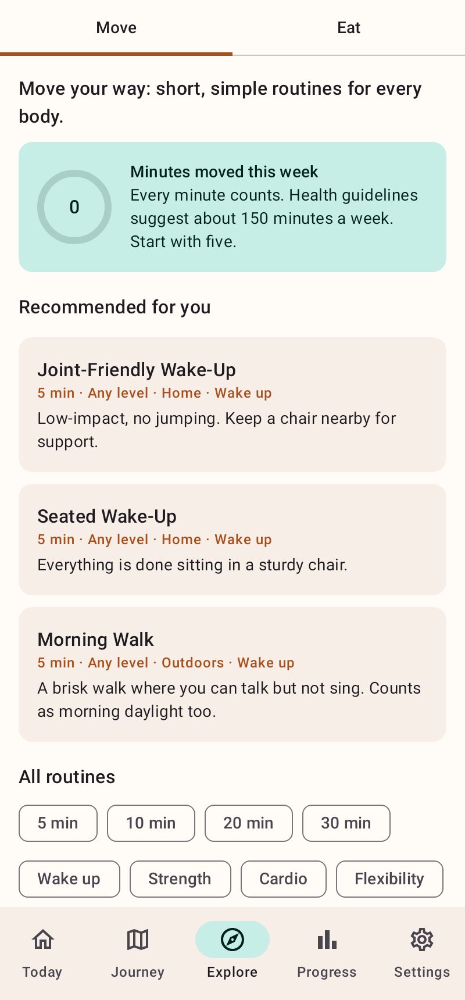 | 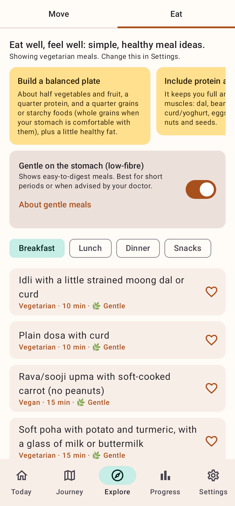 | 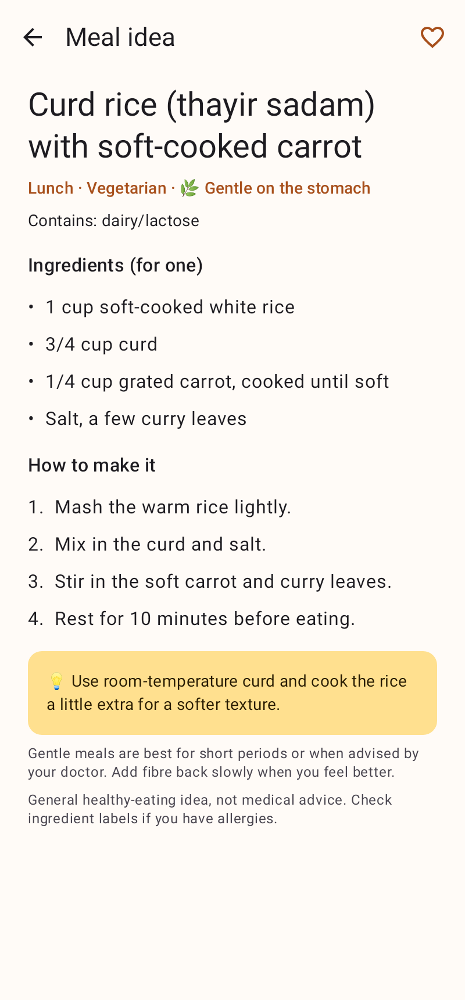 |

| **Coach note** | **Mind** | **Breathing** |
|---|---|---|
| 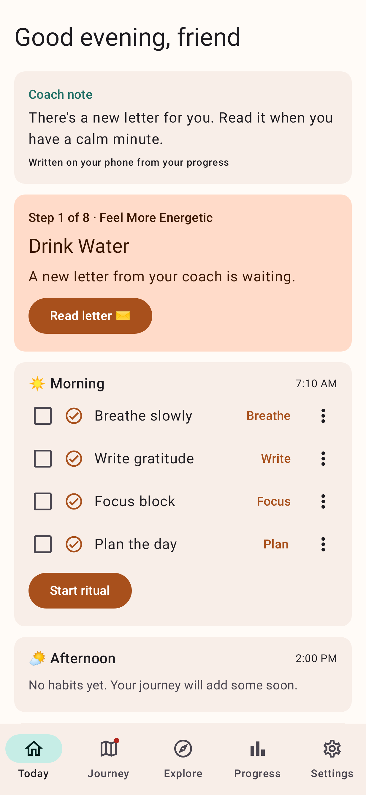 | 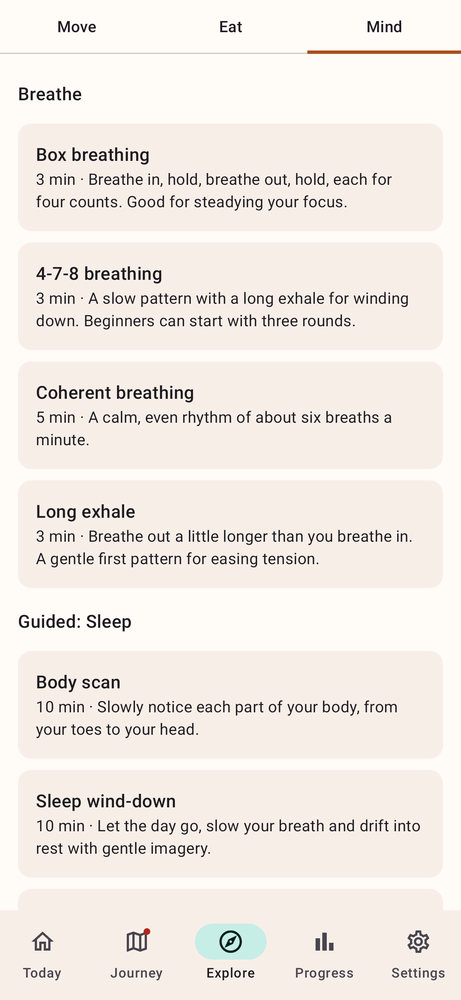 | 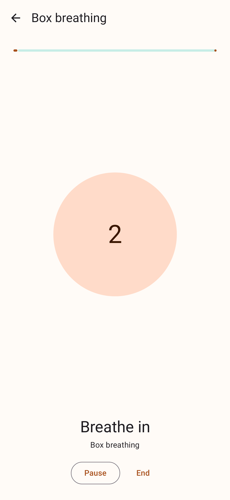 |
| **Guided session** | **Sound player** | **Focus timer** |
| 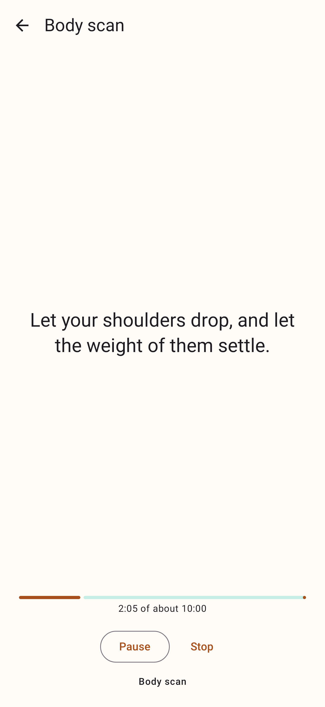 | 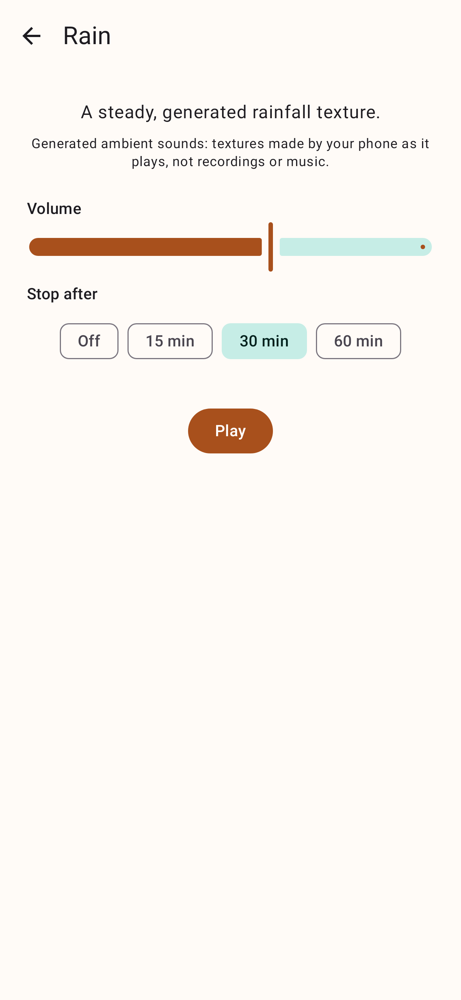 | 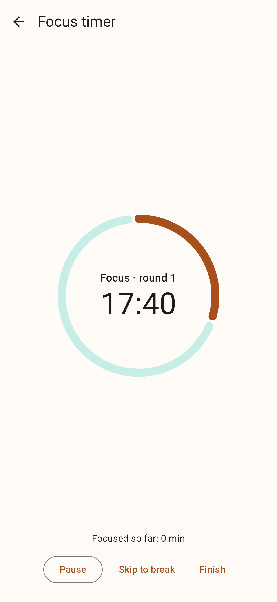 |
| **Journal** | **Steps and sleep** | |
| 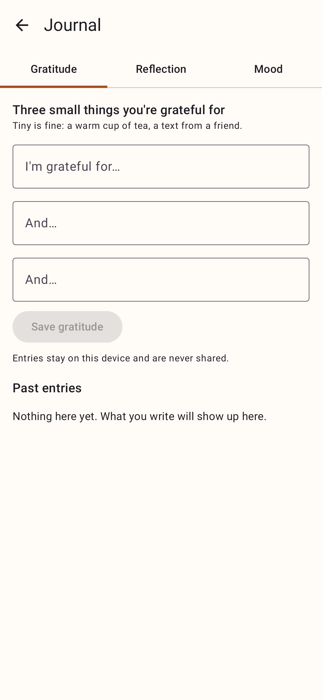 | 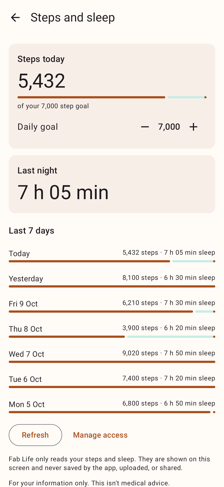 | |

Screenshots are rendered from the real app on Robolectric (with fake audio and fake Health Connect data), not from a phone.

## Features (v0.2)
- **Onboarding**: goal, obstacles, wake/bed times, diet type, sensitive-stomach question, foods to avoid, fitness level and movement needs, press-and-hold commitment. Your goal picks your first journey.
- **Five coaching journeys**, each with full letters, a habit that unlocks the next step after N days in a rolling window, supportive missed-days and welcome-back letters, and a skip-ahead option: **Feel More Energetic**, **Sleep Better**, **Focus and Achieve**, **Eat Well** (gentle-stomach notes on every food step) and **Calm Mind**. Switch journeys any time; progress in each is kept.
- **Rituals**: morning, afternoon and evening habit lists, one-tap check-ins, streaks, a guided ritual player with timers and celebrations. Habits can open a tool (Start, Breathe, Listen, Play, Focus, Write, Plan) and offer to check themselves in when you finish.
- **Explore → Move**: routines filtered by fitness level and movement needs (standard, low-impact, seated), a player with an easier version of every move, and weekly minutes against the WHO guidance.
- **Explore → Eat**: healthy meal ideas by diet type, with a **Gentle on the stomach (low-fibre)** mode, allergen filters and recipes.
- **Explore → Mind**
  - **Breathing**: a paced circle for four patterns (box, 4-7-8, coherent, long exhale), optional soft vibration, a still circle when system animations are off.
  - **Guided sessions**: ten sessions (body scan, sleep wind-down, worry unload, morning intention, stress reset, 5-4-3-2-1 grounding, gratitude, kindness, focus reset, mindful eating), read aloud by the phone's text-to-speech voice with captions always shown; if no voice is installed they run as timed captions.
  - **Sounds**: seven *generated* ambient sounds (white, pink, brown, rain, ocean waves, fan hum, focus tone) with volume and a 15/30/60 minute sleep timer that fades out. They are textures made by the phone as it plays, not recordings or music. Playback continues with the screen off and a mini-player appears on the tabs.
  - **Focus timer**: focus blocks and breaks with a long break every fourth round, editable lengths, optional focus sound, chime and vibration at the end.
  - **Journal** (gratitude, reflection prompts, mood) and **Top 3** for the day with carry-over of yesterday's unfinished tasks.
- **Coach note** on Today: a short note chosen on the phone from your progress (comeback after quiet days, streak milestones, a struggling habit, your chosen obstacles, the time of day...). Nothing is sent anywhere.
- **Steps and sleep (optional)**: read-only from Health Connect, shown on Progress and in a Health screen, never saved or shared. Everything else works without it.
- **Progress**: calendar heatmap, streaks, stats and 30-day completion per habit.
- **Reminders**: at most one notification per ritual per day, only if the ritual isn't done yet, with **Done** and **Snooze 30 min** buttons.
- **Your day**: choose when your day starts so late-night check-ins count for the day before.
- Works offline; all data stays on the device (export and reset in Settings).

## Privacy
No account, no ads, no analytics, no servers. The app does not request the INTERNET permission. Journal text, Top 3 text, check-ins and settings stay on the device. Steps and sleep are read from Health Connect only after you allow it, are shown on screen and are not stored.

## Status: what is verified and what is not
Verified by automated checks (`./gradlew testDebugUnitTest assembleDebug assembleRelease lintDebug`): the content parser and cross-references (every journey, tool and shortcut points at something that exists), the journey and streak rules, the multi-journey database and its migration, the sound generators (spectrum, level, determinism), fades, breathing pacer, guided-session runner, the audio controller state machine and foreground service (with fakes), sleep maths, the on-device coach rules, and the Compose screens driven through the real app on Robolectric.

**Needs a real device to confirm** (there was no emulator or phone in the build environment):
- how the generated sounds actually sound through speakers and headphones;
- Android text-to-speech voices and language coverage;
- the foreground playback service on different manufacturers' phones and Android versions;
- Health Connect permission screens and real data;
- vibration, the chime and notification delivery.

**Not built yet**: Claude-written coach notes with your own API key (designed in `docs/DESIGN_PHASE2.md` section 11); the focus timer only alerts while the app is open.

## Build and test
Requires JDK 17+ and the Android SDK (API 35).

```bash
./gradlew testDebugUnitTest   # unit tests + Robolectric UI flow tests
./gradlew assembleDebug       # app/build/outputs/apk/debug/app-debug.apk
```

CI (`.github/workflows/android.yml`) runs the tests and uploads debug and release APKs as the `fablife-apks` artifact.

Journey letters, guided sessions, routines and meal ideas live in `app/src/main/assets/`, generated from the Markdown docs:

```bash
python3 tools/validate_content.py   # word counts, ids, tools, banned phrases
python3 tools/build_content.py
```

## Project layout
```
app/src/main/java/io/github/sreepv43/fablife/
├── content/        # content models + JSON parsing (no Android imports)
├── engine/         # journey rules, streaks, recommendations, focus plan, Top 3, journal prompts (no Android imports)
├── audio/          # generated sounds, fades, breathing pacer, guided-session runner (no Android imports)
├── audio/android/  # AudioTrack engine, text-to-speech, audio controller, foreground service
├── health/         # Health Connect access and sleep maths
├── coach/          # on-device coach notes (no Android imports)
├── data/           # Room database (v2), DataStore prefs, repositories
├── notifications/  # ritual reminders (AlarmManager)
└── ui/             # Compose screens: onboarding, today, ritual, journey, explore, mind, progress, health, settings
```

## Docs
- [Product specification](docs/PRODUCT_SPEC.md)
- [Phase 2 design contract](docs/DESIGN_PHASE2.md)
- Journeys 2 to 5: [Sleep](docs/journeys/02-sleep-better.md), [Focus](docs/journeys/03-focus-and-achieve.md), [Eat Well](docs/journeys/04-eat-well.md), [Calm Mind](docs/journeys/05-calm-mind.md)
- Guided sessions: [sleep and focus](docs/audio/sessions_sleep_focus.md), [calm and morning](docs/audio/sessions_calm_morning.md)
- [Journey 1: Feel More Energetic (full content)](docs/journeys/01-feel-more-energetic.md)
- [Exercise recommendations](docs/content/EXERCISE_LIBRARY.md)
- [Healthy food recommendations (incl. gentle low-fibre option)](docs/content/FOOD_GUIDE.md)
