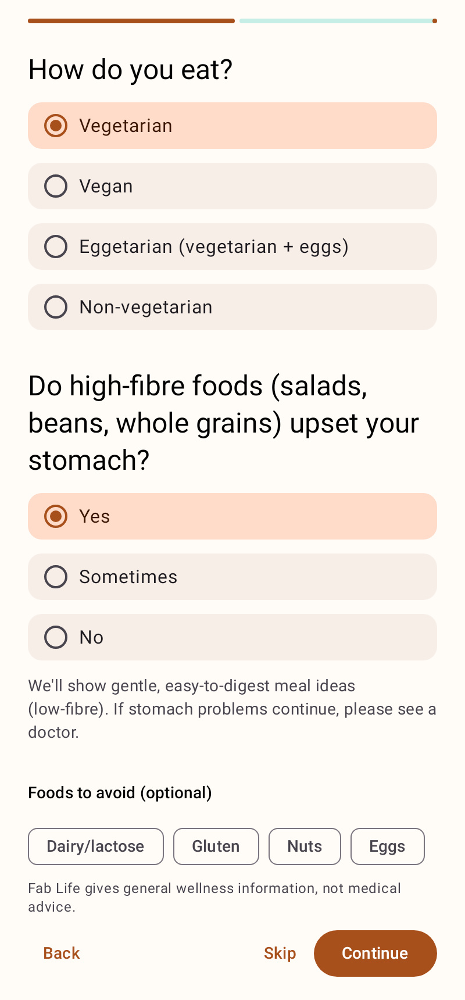

# Fablife
Healthy habit app

Fab Life is an Android app (Kotlin, Jetpack Compose) that helps people build a healthier lifestyle one tiny habit at a time through guided coaching journeys and daily rituals.

| Today | Coach letter | Journey |
|---|---|---|
|  |  |  |
| **Move** | **Eat (gentle mode)** | **Onboarding** |
|  |  |  |

## Features (v0.1)
- **Onboarding**: goal, obstacles, wake/bed times, diet type, sensitive-stomach question, foods to avoid, fitness level and movement needs, press-and-hold commitment.
- **Journey 1, Feel More Energetic**: 8 steps with full coaching letters; a habit unlocks the next step after N days in a rolling window. Includes supportive missed-days and welcome-back handling and a "skip ahead" option.
- **Rituals**: morning, afternoon and evening habit lists, one-tap check-ins, streaks, a guided ritual player with timers and celebrations.
- **Explore → Move**: exercise routines filtered by fitness level and movement needs (standard, low-impact, seated), a routine player with an easier version of every move, and weekly minutes against the WHO guidance.
- **Explore → Eat**: healthy meal ideas by diet type, with a **Gentle on the stomach (low-fibre)** mode and allergen filters.
- **Progress**: calendar heatmap, streaks, stats and 30-day completion per habit.
- **Reminders**: at most one notification per ritual per day, only if the ritual isn't done yet.
- Works offline; all data stays on the device (export and reset in Settings).

## Build and test
Requires JDK 17+ and the Android SDK (API 35).

```bash
./gradlew testDebugUnitTest   # unit tests + Robolectric UI flow test
./gradlew assembleDebug       # app/build/outputs/apk/debug/app-debug.apk
```

CI (`.github/workflows/android.yml`) runs the tests and uploads debug and release APKs as the `fablife-apks` artifact.

Journey letters, exercise routines and meal ideas live in `app/src/main/assets/*.json`, generated from the Markdown docs:

```bash
python3 tools/build_content.py
```

## Project layout
```
app/src/main/java/io/github/sreepv43/fablife/
├── content/        # content models + JSON parsing (no Android imports)
├── engine/         # journey rules, streaks, recommendations (no Android imports)
├── data/           # Room database, DataStore prefs, repositories
├── notifications/  # ritual reminders (AlarmManager)
└── ui/             # Compose screens: onboarding, today, ritual, journey, explore, progress, settings
```

## Docs
- [Product specification](docs/PRODUCT_SPEC.md)
- [Journey 1: Feel More Energetic (full content)](docs/journeys/01-feel-more-energetic.md)
- [Exercise recommendations](docs/content/EXERCISE_LIBRARY.md)
- [Healthy food recommendations (incl. gentle low-fibre option)](docs/content/FOOD_GUIDE.md)
